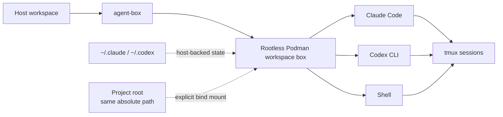

<div align="center">

# agent-box

**Run Claude Code and Codex CLI in isolated, reusable Podman workspaces.**

One project. One shared container. Your agents, shell, tools, state, and detachable sessions stay together without giving the container your whole host.

[](https://github.com/rus364/agent-box/actions/workflows/ci.yml)


</div>

---

## Why agent-box?

AI coding agents are useful, but running them directly on your workstation gives
them the same filesystem, credentials, tooling and process access that you have.

`agent-box` puts Claude Code and Codex CLI inside a transient rootless Podman
container while keeping the workflow close to local development:

- **Workspace isolation** — only the resolved project root and explicitly requested mounts are exposed.
- **Shared workspace box** — Claude, Codex and `agent-box shell` run in the same container for a project.
- **Same paths as the host** — a project at `/home/you/code/project` is at `/home/you/code/project` inside the box too.
- **Persistent agent state** — authentication, settings and history stay in host-backed `~/.claude` and `~/.codex`.
- **Detachable sessions** — interactive sessions run under tmux and survive a closed terminal or a dropped SSH connection.
- **Nothing exposed by accident** — every credential, every host directory and every optional capability is a switch you turned on.

> [!IMPORTANT]
> A workspace box is one trust boundary. Claude, Codex, shells, hooks and
> daemons inside the same box share the same Unix user and PID namespace.

## Installation

Requirements: Linux, Python 3.11+, Podman and Git. `gh` is optional, and only
for passing a GitHub token into the box. The launcher itself uses only the
Python standard library — there is nothing to build and nothing to install into
Python.

Git is a real dependency, not just how you get the code: agent-box asks it for
the repository root to decide what to mount, and reads it for the status line
and the auto-push safety checks.

**1. Clone it.** Anywhere you like; this is the whole program.

```bash
git clone https://github.com/rus364/agent-box.git ~/.local/src/agent-box
```

**2. Configure it.** Run it by path the first time — its first question is
putting `agent-box` on your PATH:

```bash
~/.local/src/agent-box/agent-box config
```

It offers the writable directories your PATH already has, or creates
`~/.local/bin` and adds it. While your shell cannot find `agent-box`, the menu
opens on that question, says so in the row itself, and asks once more before
saving without it. The symlink and the shell startup line are two separate
questions, both declinable, and declining either prints the exact command to
run yourself. The directory you pick is saved, so if the symlink later
disappears — a `~/.local/bin` rebuilt by another installer, a restored home —
`agent-box config apply` puts it back. Everything after that is optional
integrations, all off by default.

**3. Authenticate the agents on the host.** agent-box mounts your existing
`~/.claude` and `~/.codex` rather than managing a second credential store, so
`claude` and `codex` should be logged in before the first launch.

**4. Run it.** The container image is built automatically on first use, which
takes a few minutes once:

```bash
cd ~/code/my-project
agent-box claude          # or: agent-box codex
```

Then, day to day:

```bash
agent-box shell       # shell in this project's box
agent-box attach      # reattach a detached session
agent-box stop        # end the box and every session in it, and stop its k3s cluster
agent-box doctor      # verify the environment
agent-box upgrade     # move this checkout to the newest release
```

**Shell completion** (optional). Add one line to `~/.bashrc`, or to `~/.zshrc`
after `compinit`:

```bash
source <(agent-box completion bash)   # zsh: source <(agent-box completion zsh)
```

agent-box computes the candidates on every Tab from the same tables that parse
the command line, so new options and commands complete without regenerating
the script.

## How it works



The first command in a project creates its box lazily. Later Claude, Codex and
shell commands for the same workspace join that box with `podman exec`. A
different workspace gets a different box. When no useful workload remains, the
box exits and Podman's `--rm` removes it.

## Daily usage

```bash
agent-box                  # default agent: Claude, or Codex if chosen in agent-box config
agent-box claude -p "summarize this repository"
agent-box codex exec "inspect this repository"
```

Choose the default under **Agents → Default agent** in `agent-box config`
(`agents.default`: `claude` or `codex`). It is a global setting, not a
project one; an explicit `claude` or `codex` always wins.

With no running workspace box, a launch creates one from the current settings
and flags. Otherwise `shell` (including `shell -c ...`), `doctor`, and new
agent sessions enter that same box without repeating its creation flags.
The box keeps its image, mounts, devices, k3s and shared access choices;
the new process uses its own workflow and session settings. `doctor` reports
the running box. `attach` returns to an existing tmux session; `--host` runs
outside the box.

An explicit option that conflicts with the live box names the conflict and
asks you to end it with `agent-box stop`, then rerun. Matching shared-access
flags and already mounted paths are accepted. Changing saved settings alone
does not replace or reconfigure a running box.

### Session options

Options before the agent change one launch and are never saved; `agent-box
--help` lists them all. Launch options shape only the launch itself. Workflow,
tracker and access options apply over the global and project configuration,
travel in the session snapshot (so nested launches inside the session inherit
them), and `agent-box config show` inside the session names them.

```bash
agent-box --reviewer claude:opus:high --review always codex
agent-box --worker codex:gpt-5.5:high --no-push claude
agent-box --host --no-tmux codex exec "run the tests"
```

| Group | Options |
| --- | --- |
| Launch | `--host`, `--workspace PATH`, `--mount PATH[:ro]`, `--env NAME[=VALUE]`, `--no-tmux`, `--no-kvm` |
| Workflow | `--worker SPEC`, `--reviewer SPEC`, `--scout SPEC`, `--sync SPEC`, `--[no-]tiers`, `--review off\|auto\|always`, `--rounds N`, `--merge github\|local`, `--[no-]push`, `--no-workflow` |
| Tracker | `--tracker URL`, `--project ID` ([details](#project-configuration)) |
| Access | `--[no-]gh-token`, `--[no-]gh-config`, `--[no-]git-config`, `--[no-]registries`, `--[no-]kubeconfigs`, `--[no-]cloud-profiles`, `--[no-]api-keys`, `--no-browser`, `--[no-]remote-control`, `--[no-]notify` |

`SPEC` is `PROVIDER[@API]:MODEL[:EFFORT]`, for example `codex:gpt-5.5:high` or
`claude@deepseek:deepseek-v4`. `--reviewer`, `--scout`, `--sync` and `--worker` pin
that model outright: the role's candidate lists and task tiers choose no other. `--[no-]tiers` decides for the session whether a task's tier selects worker, sync and reviewer lists. Workflow options need workflow enabled in
`agent-box config`. Options that only a container can honour (mounts, KVM,
credentials, browser) are refused with `--host` rather than ignored.

### Detach and reattach

Interactive `claude`, `codex` and `shell` sessions run under tmux inside the
box, so closing the terminal detaches instead of orphaning. Detach on purpose
with `Ctrl-\ d`, come back with `agent-box attach`, and name a session
explicitly when several exist:

```bash
agent-box attach claude-31337
```

A detached session keeps its box alive; `agent-box stop` ends the box and every
session in it.

The mouse wheel scrolls tmux history when the agent does not handle mouse
events itself; mouse-aware TUIs receive the events directly. Press `q` to leave
tmux's scroll mode. This uses agent-box's private tmux configuration.
For an already running server, apply the setting from `agent-box shell` with
`tmux -L agent-box set -g mouse on`; new servers load it automatically.

Only real terminals are wrapped — pipes, redirects, CI and `claude -p` write
straight to stdout. `--no-tmux` disables tmux for one launch.

A wrapped session that fails reports its exit status and nothing else: the pane
is destroyed with the session, so whatever the command printed before it died
goes with it. Rerun with `--no-tmux` to read it on the terminal.

### Extra mounts

The project root is the only workspace path mounted automatically:

```bash
agent-box --mount ~/code claude
agent-box --mount /mnt/data/specs:ro --mount /srv/generated codex
```

Mounts keep their host absolute paths inside the container, and are read-write
unless you append `:ro`.

### Extra environment variables

```bash
agent-box --env DATABASE_URL=postgres://localhost/dev codex
agent-box --env MY_TOKEN claude
```

`--env NAME=VALUE` sets a variable. `--env NAME` forwards the value that name
already has in your shell *without* putting it in the process list, which is the
form to use for anything secret. Both are repeatable and both win over the lists
stored in `agent-box config`.

The same request works as a shell prefix:

```bash
AGENT_BOX_ENV_DATABASE_URL=postgres://localhost/dev agent-box codex
```

A bare `DATABASE_URL=... agent-box codex` cannot work, and the namespace is why:
inside the process, a variable set by a shell prefix is indistinguishable from
the hundreds inherited from your login profile, so honouring bare names would
mean handing the container your entire host environment.

### Host mode

```bash
agent-box --host              # default agent, chosen as without --host
agent-box --host claude
agent-box --host codex
agent-box --host attach       # return to a host session in this project
agent-box --host stop         # end this project's agent-box host sessions
```

Runs the installed CLI directly, with your normal host environment and
credentials — no Podman. Tracker commands, task workflow, model routing and
parent-branch push policy are shared with container mode. The
[agent browser](docs/integrations/browser.md) is not: it is a capability of the
workspace image, and agent-box never rewrites your host agent configuration to
fake one. Nor is the [k3s cluster](docs/integrations/k3s.md): a host agent keeps
your own kube contexts.

Interactive host sessions use an installed `tmux` and `bash` with agent-box's private
configuration and one private server per project. They survive a closed
terminal; detach with `Ctrl-\ d` and return with `agent-box --host attach`
(optionally followed by a session name). Each launch receives its own current
environment and working directory. `--host stop` affects only that project's
agent-box host server, leaving other projects and your own tmux servers alone.
Without tmux, the CLI starts directly with a short notice. `--no-tmux`,
pipes, redirects and noninteractive commands such as `claude -p` and `codex exec`
also use direct execution. Agent-box never installs tmux at launch.
Bash is resolved from the caller's PATH before starting tmux; if it is missing,
install it or use `--no-tmux` for direct execution.

| Area | Host responsibility / agent-box behavior |
| --- | --- |
| CLI, tools and authentication | You install and authenticate them; normal host file and network access applies. |
| Main CLI permissions | Native CLI settings and your explicit arguments; no added permission/sandbox bypass. |
| Tracker, workflow, project settings | Shared policy and a per-session configuration snapshot. Managed delegates retain workflow's role-specific policy. |
| Environment and Git/gh | Inherited host environment plus explicit env settings; container credential-forwarding switches do not restrict host access. |
| Skills and owned integrations | Applied by `config` / `config apply`; launching does not rewrite user configuration. Existing host plugins remain under the CLI's configuration. |
| Image, mounts, browser, k3s cluster, shell/doctor | Container-only. Host tooling is not provisioned from the image. |

Telegram control and notifications have their own integration contract; see
[Telegram](docs/integrations/telegram.md).

## Configuration

Global overrides are stored in a versioned JSON file:

```text
~/.config/agent-box/config.json
```

Configuration has three layers: built-in `Config()` defaults, global overrides,
then project overrides. Global saves keep only settings that differ from the
program defaults, plus `version: 1`; missing nested settings inherit defaults.
The Python configuration dataclasses define those defaults, with no separate
JSON template. A new project starts without overrides.

```bash
agent-box config        # menu: arrows, Space, Enter; save and apply
agent-box config show   # print current settings, tokens redacted
agent-box config check  # verify the Claude Telegram channel setup
agent-box config apply  # apply the saved file without asking anything
agent-box config ai     # set things up together with an agent; see below
```

`agent-box config` uses Python’s standard-library curses menu, with no extra
packages or installer. It keeps the terminal's default background and remains
usable down to 40 columns by 8 rows. Up and Down move, Space toggles or cycles
the current value, Enter opens a section, choice list, or editor, `?` opens the
complete scrollable help for the selected item, and Escape goes back without
the usual curses delay. Home/End and Page Up/Down navigate long lists; group
headings inside a section are skipped. A choice list describes the value under
the cursor, and `?` there shows the setting's own help. A list of fixed values,
such as Plan sync events, opens as checkboxes: Space toggles, Enter keeps,
Escape discards. Details sit beside the list on wide terminals and below it on
narrow ones. Editors
support cursor movement, Home, End, Backspace, Delete, insertion, and long
values; secret values remain masked. F1 shows the editor's keyboard help.
In the global editor, **R: Reset to default** restores the selected field or
section to built-in program values and removes its stored override on save.
Reset changes only the draft until you save.

Worker, scout, Plan sync and reviewer models are ordered candidate lists: add, reorder,
change effort or fast, or remove a candidate. The picker offers Codex, Claude
and enabled external API models together with manual model-ID entry per CLI and
API, because any CLI's model may serve any role; a model of the other CLI than
the coordinator's runs as a managed process. Codex suggestions come from its
local model cache when usable and otherwise from agent-box's bundled hints;
Claude uses bundled stable aliases and model IDs. These lists are hints rather
than availability checks. Existing custom values remain editable, Escape
restores the previous value, and a change affects only the list being edited.

[External API providers](docs/integrations/external-providers.md) are named global
connections with a private key and separate Codex/Claude URLs and model lists.
Each candidate's **Model** list combines built-in models and configured models
from enabled external APIs; selecting a row sets the API and model together.
`agent-box [--host] ext NAME [codex|claude]` starts an explicit external
session; without claude/codex it uses the default agent.

Cancel writes nothing. Save and apply performs the selected changes, including
optional PATH setup: restoring the `agent-box` symlink in the directory you
chose, installing the skills your integrations need, linking them for Claude,
rendering credential files, and reconciling Claude's `settings.json`.
`agent-box config apply` does the same from the saved file, without any
questions — which is what you want after editing `config.json` by hand.
`agent-box upgrade` applies on its own once it has moved the checkout, so a
newer agent-box never leaves you with its older skills installed.

Inside a workspace box the saved file is deliberately not mounted, so
`agent-box config apply` applies the rendered session configuration instead:
the shipped skills and the configured agent profiles — which is also the way a
skill edited in this checkout reaches the box. Notifications, hooks, the status
line, credentials, PATH and Claude's skill links are host-only and stay as they
are; the interactive menu, which edits the saved file, refuses in a box.

**Starting an agent applies nothing.** `agent-box claude` and `agent-box codex`
read your configuration but never install a skill, write a symlink or rewrite
`settings.json` on the way past. A launch is safe to run without wondering what
it will change in your home directory, and anything that shows up there is there
because you asked for it.

### Defaults

| Setting | Default | Purpose |
| --- | --- | --- |
| Default agent | claude | What a bare `agent-box` starts; an explicit `claude`/`codex` wins |
| Claude status line | on | Workspace, git state, context and provider usage in one line |
| Git identity | on | `user.name` / `user.email`, for commit attribution |
| Provider transport settings | on | Base URL, proxies, CA bundle — without these a container behind a proxy cannot reach the network |
| Share skills with Claude | on | Link `~/.agents/skills` into `~/.claude/skills` |
| Image tool groups | analysis, kubernetes | What the workspace image is built with |
| Everything else | **off** | Credentials, task tracking, browser, k3s cluster, host audio, notifications, workflow (auto-push defaults on within opt-in workflow) |

Every switch and what it exposes: **[docs/integrations](docs/integrations/)**.

### Environment variables

```text
AGENT_BOX_IMAGE           Container image name
AGENT_BOX_STATE_DIR       Override ~/.local/share/agent-box
AGENT_BOX_CONFIG_DIR      Override ~/.config/agent-box
AGENT_BOX_AGENTS_DIR      Override ~/.agents, the shared agent/skill tree
AGENT_BOX_STATUSLINE=0    Leave Claude's statusLine untouched when applying
AGENT_BOX_ENV_<NAME>      Set <NAME> inside the session
```

Choices for one launch are [session options](#session-options), not variables.


## Project configuration

`agent-box config` edits global settings. `agent-box config --project` uses the
same menu to edit `.agent-box.json` at the Git repository or worktree root.
Commands from subdirectories use that root too. Outside Git, the current
directory is used for launch settings. Tracker/workflow operations that need a
bound project still require a complete tracker binding.

```json
{
  "tracker": {
    "provider": "vikunja",
    "project": "12",
    "recursive": true,
    "connections": {"vikunja": {"url": "https://tasks.example.org"}}
  },
  "workflow": {"auto_push": false},
  "box": {"tools": {"browser": true}}
}
```

The allowed shared paths are `workflow` except its top-level `enabled`,
`box.tools`, `box.k3s`, `tracker.provider`, and
`tracker.connections.<provider>.url`. Workflow includes each role's candidate lists
(`models`, and `tiers.N` for workers, sync agents and reviewers) and `use_tiers`. `tracker.project` and `tracker.recursive` are
project identity fields. Missing fields inherit global settings; nested objects
merge by key and lists replace the whole inherited list. Explicit `false`,
empty lists, and allowed empty strings
remain choices. Unknown fields, wrong types and invalid JSON are errors.

The project menu labels values **Inherited** or **Overridden**. **R: Reset to
default** removes the selected field or section's override, so it inherits the
effective global value and follows subsequent global changes. **G: Copy current global**
copies the current effective global value into an explicit project override,
pinning it against subsequent global changes. Both actions work on fields and
sections. The available global baseline comes from the session runtime snapshot
when present, otherwise the host configuration; a session's `--tracker`
account is excluded from copying. A temporary session retains the original
global URLs for the editor, without retaining the replaced global token.
Section copying includes only project-allowed settings. Copying tracker connections
removes project-only accounts absent from the global section; copying the enclosing
tracker section preserves its project ID and recursive choice. Empty menu
placeholders are not configured accounts. Choosing a
value equal to the global or program default still saves an explicit project
override. Project identity fields have no global value to copy; the menu explains
why Copy current global is unavailable there. Copying an empty required URL still requires
editing it before saving. Credentials, environment configuration, integration
enablement and host installation settings remain **Global only** and cannot
be edited here; the label is red when the terminal supports color and keeps
the terminal's default background. **Save project** writes only explicit
project values; **Cancel** discards the draft. Neither applies host integrations
nor configures PATH. Image tool changes still require an explicit image rebuild.

Credentials and environment policy belong outside the repository. Every
agent-box command validates the project file before its command actions.
Recognized credential fields are forbidden even when empty or null; the error
includes `PROJECT_CREDENTIALS_FORBIDDEN`, the file and field path, without its
value. URL credentials, queries and fragments are rejected. This checks the
allowed schema and credential fields, not arbitrary strings for possible
secrets, and does not inspect Git history or control commands outside agent-box.

The saved global account must match the project URL; moving a server
permanently requires updating the binding. A project URL never redirects a
global token, and `tracker.enabled` remains a global permission.

For one session, `--tracker URL` selects another server and `--project ID`
another project; together they bind even an unbound repository. Both need
the tracker enabled in `agent-box config`; a session cannot open that gate. The token is
read by name from `VIKUNJA_TOKEN` in the launching shell, never from an
argument or the stored environment lists, and reaches the session only through
its private snapshot. Neither configuration file changes:

```bash
export VIKUNJA_TOKEN=...
agent-box --tracker https://tasks.example.org --project 12 codex
```
Temporary account values are never saved in global or project configuration,
and configuration display masks credentials and environment assignments.
Launches use immutable session snapshots in agent-box runtime state. Each
workspace's container mount includes only that workspace's snapshots; host
snapshots are outside container mounts. Sessions sharing one workspace box
can access its snapshots. With tracker and workflow disabled, only a separate
credential-free policy directory is mounted; no account or environment values
are rendered there. Each consumer applies its current project's
overrides to the snapshot's global baseline, so another project/session or a
global apply cannot replace an active session's settings or credentials.
Snapshots remain available for detached sessions and are removed with runtime
state during uninstall.

### Guided setup with `config ai`

`agent-box config ai [claude|codex]` starts an ordinary interactive session in
this workspace's box — the default agent and its configured model unless you
name one — whose first prompt is the shipped `ab-config` skill. The agent reads
the repository and `agent-box config describe`, asks about your goals in your
language, and explains each recommendation: its purpose, consequences and
alternatives, and whether it belongs to the project or to your global
configuration. Starting it installs nothing and applies nothing.

The agent writes only through checked commands, after showing you the change:

```bash
agent-box config describe [PATH]    # every setting as JSON, secrets redacted
agent-box config set --project [--dry-run] PATH=JSON... [--reset PATH]...
agent-box config set --global [--dry-run] PATH=JSON... [--reset PATH]...
agent-box config proposal [apply | discard]
```

Project changes are validated as a whole `.agent-box.json` and saved with a
diff. An agent never writes global settings: `config set --global` saves a
proposal in the checkout's Git directory (`.git/agent-box/`, never committed),
checked against the global configuration the session can see.
`agent-box config proposal apply` runs in your own host terminal, outside agent
sessions: it rechecks the proposal against the saved `config.json`, shows the
changed settings, and saves and applies them only after you answer yes.
`config ai` offers a pending proposal before the session and again when it ends
or detaches. Credentials, tokens, API keys, environment and installation
settings are never read or proposed this way; set them in `agent-box config`.
Image tool changes still need `agent-box build`.


## The workspace image

A base set everyone gets, plus optional groups you choose under **Workspace box → Image tools** in `agent-box config` (`box.tools.<group>`).

| Always | Included |
| --- | --- |
| Agents | Claude Code, Codex CLI |
| Languages | Python, uv, Node.js 22, Bun, mise |
| Source control | git, git-lfs, gh |
| Shell tooling | tmux, jq, ripgrep, fd, fzf, just, build essentials, network utilities |

| Optional group | Default | Included |
| --- | --- | --- |
| `analysis` | on | shellcheck, sqlite3, jscpd |
| `kubernetes` | on | kubectl, Helm, yq |
| `virtualization` | off | QEMU x86-64 + aarch64, OVMF; also gates `/dev/kvm` passthrough |
| `podman` | off | Nested rootless Podman, userspace networking and image builds (see [nested Podman](docs/nested-podman.md)) |
| `skopeo` | off | skopeo for inspecting, copying and listing images in registries, without Podman's namespace permissions |
| `browser` | off | Playwright MCP + headless Chromium, wired into every box session (see [agent browser](docs/integrations/browser.md)) |
| `yc` | off | Yandex Cloud CLI; ticked for you when [cloud CLI profiles](docs/integrations/cloud-profiles.md) are forwarded |

Anything else your projects need belongs in the project, through `mise` — a
per-project toolchain is not an image everyone shares. A tool you add for
yourself with `mise use -g`, and a project config you `mise trust`, survive box
recreation: mise's installs, global config and trust records live in agent-box
state shared by every box, apart from the host's own mise.

**Workspace box → k3s cluster** is not an image group. It runs a per-project
[k3s cluster](docs/integrations/k3s.md) in a sidecar container beside the box
(`box.k3s.enabled`, off by default).

```bash
agent-box build      # normal cached build
agent-box update     # refresh frequently updated tools
agent-box rebuild    # rebuild without cache
```

The image uses Ubuntu 26.04 LTS. `build` and `update` reuse the local base;
`rebuild` pulls the base and disables layer reuse. `update` refreshes Codex,
Claude, Node.js 22, mise, uv,
Bun and enabled Kubernetes tools. Pinned Playwright/Chromium and jscpd stay
above the refresh boundary and are reused when their inputs are unchanged.
Changing the base, earlier instructions or build arguments can rebuild them.

APT package archives and npm downloads use persistent, builder-owned cache
mounts (`agent-box-apt` and `agent-box-npm`), outside the resulting image and
separate from runtime workspace caches. Installs still check current versions.
`rebuild` bypasses cached layers but retains these download caches; it does not
purge Podman storage. A cold or pruned builder downloads packages again.

Changing a group takes effect on the next `agent-box build`. The image records
what it was built with, so `agent-box config show`, `agent-box doctor` and any
launch will tell you when the running image no longer matches your
configuration — and none of them rebuild it behind your back.

Default image: `localhost/agent-box:latest`, overridable with `AGENT_BOX_IMAGE`.

## Integrations

All off by default and independent of each other. See
**[docs/integrations](docs/integrations/)** for the full set; briefly:

- **[Shared skills](docs/integrations/skills.md)** — one skill tree both agents read, plus three engineering-practice skills agent-box ships.
- **[Tracker](docs/integrations/tracker.md)** — portable task commands, repository setup and a working Vikunja API v2 provider.
- **[Workflow](docs/integrations/workflow.md)** — sequential tracked work, configurable provider/model routing, fresh review and parent GitHub PRs.
- **[Agent browser](docs/integrations/browser.md)** — a headless browser inside the box for agents to drive.
- **[k3s cluster](docs/integrations/k3s.md)** — a per-project Kubernetes cluster in a rootless sidecar, with `kubectl` access from the box.
- **[Host audio](docs/integrations/audio.md)** — the host microphone and speakers in the box, e.g. for Claude Code `/voice`.
- **[Telegram](docs/integrations/telegram.md)** — Anthropic's official control channel, plus one-way notifications.
- **[Remote Control](docs/integrations/remote-control.md)** — optional native remote access for new Claude/Codex sessions, with ordinary-launch fallback.
- **[External API providers](docs/integrations/external-providers.md)** — named API connections for either CLI and managed workflow roles.
- **[Git and GitHub](docs/integrations/git.md)** — what of your Git and GitHub setup reaches a session.

## Usage and status line

```bash
agent-box usage codex
agent-box usage claude
agent-box usage all
agent-box usage all --no-cache
```

```text
97/88 · 4h51m/5d23h │ 83/61 · 3h24m/4d11h
```

Segments are unlabeled: Claude first, Codex second, each in its own muted hue
(terracotta and steel blue; the status line adds violet for context).
Single-provider invocations print plain — the colours exist only to separate
segments from each other.

`--no-cache` always requests live usage. Claude tokens are renewed on demand
only after expiry or HTTP 401, at most once per call; there is no background
refresh. Status-line reads never renew credentials. A busy credential lock or
failed renewal returns an error; model selection still skips a candidate whose
cached window is known to be exhausted until its reset.
Renewal honors Claude's approved custom OAuth origins; an arbitrary usage
endpoint override never receives a refresh token.

Claude Code can also use:

```bash
agent-box statusline
```

which renders workspace, git state, context usage and provider limits in one
line. It is enabled by default, but agent-box fills Claude's `statusLine` slot
only when that slot is empty, and removes only its own command when switched off
— a status line you configured yourself is never touched.

That slot lives in `~/.claude/settings.json`, which Claude sessions started
outside agent-box read too, so the line follows you there as well.
`AGENT_BOX_STATUSLINE=0` leaves the file alone while applying, and
`agent-box uninstall` takes the line back out for good.

## Workspace and security model

Workspace resolution is intentionally simple:

1. Inside a Git worktree: its top-level directory.
2. Outside a Git worktree, including beneath a bare repository: the current directory.
3. `--workspace PATH` overrides both, when you deliberately want a broader tree.

By default, every workspace box runs with:

```text
--userns=keep-id
--cap-drop=all
--security-opt=no-new-privileges
```

The opt-in `podman` image group retains these flags and adds `SETUID`/`SETGID`,
`/dev/net/tun`, unmasked `/proc` paths and two seccomp syscall allowances for
nested namespace setup. It does not enable privileged mode or expose a host
container-engine socket. See [nested Podman](docs/nested-podman.md) for the
scope and limitations.

The container user mirrors the host user's real passwd identity, so files
created inside the workspace map back to you rather than to root. Only the
workspace root, explicit extra mounts, agent state directories and the
integrations you enabled are exposed.

`$HOME` is never consulted for any of this: paths come from the passwd entry, so
a poisoned environment cannot move a bind mount, a state directory or the
container's home.

## Updating

```bash
agent-box upgrade           # fetch, move to the newest release, apply
agent-box upgrade --check   # report what is available, change nothing
```

Installing agent-box is a `git clone`, so upgrading it is a git operation on
that checkout: it moves to the newest release tag, or fast-forwards the
tracking branch while the repository has no tags yet. It refuses on a checkout
with uncommitted changes or with commits no remote has — that is a working
copy, not an installation, and the alternative to refusing would be stashing
your work. Afterwards it applies your saved configuration, because the skills
agent-box ships live in the checkout that just moved.

Changing the tool groups still needs an explicit `agent-box build`; upgrading
says when the image has drifted and leaves the decision to you.

## Uninstalling

```bash
agent-box uninstall
```

Removes what agent-box wrote in places it does not own: its status line and
hooks in Claude's `settings.json`, the skill links in `~/.claude/skills`, the
skills it installed in `~/.agents/skills`, its rendered credential files, the
symlink it put on your PATH, and every workspace box. Anything you wrote
yourself in those places stays.

The PATH line in your shell startup file is the exception. It is left alone by
default — a stray `export PATH` costs nothing, while deleting the wrong two
lines of a login shell's startup file costs a lot — and `--purge` removes it
only if it still matches, character for character, what agent-box wrote. An
edited block is reported with its file and line numbers for you to decide
about, never guessed at.

Your configuration and state survive, so running `agent-box config` again picks
up where you left off. Add `--purge` to delete those too — that includes stored
tokens, so it asks first unless you pass `--yes`. The container image and this
checkout are never removed for you; the command prints how.

## Diagnostics and tests

```bash
agent-box doctor      # inside a real box: tools, credentials, integrations
agent-box selftest    # fast, no Podman, no network
python3 -m unittest discover -s tests
```

The full suite exercises workspace resolution, identity handling, configuration
gates, mounts, tmux and session lifecycle, notifications, tracker/workflow policy, Git
safety checks, skill installation and container behaviour.

## Troubleshooting

<details>
<summary><strong>Podman is missing</strong></summary>

Install Podman. agent-box intentionally does not fall back to Docker.

</details>

<details>
<summary><strong>Claude or Codex is not authenticated</strong></summary>

Authenticate the corresponding CLI on the host first. agent-box mounts the
host-backed agent state rather than managing a second credential store.

</details>

<details>
<summary><strong><code>gh</code> is unauthenticated inside the box</strong></summary>

That is the default. See [Git and GitHub](docs/integrations/git.md).

</details>

<details>
<summary><strong>The configured workspace root rejects my current directory</strong></summary>

`--workspace` names a directory that does not contain the current one.
Change directory, or pass another path.

</details>

<details>
<summary><strong>A tool I expected is missing from the box</strong></summary>

Check `agent-box config show` — its group may be off — then `agent-box build`.
Project-specific toolchains belong in the project, declared through `mise`.

</details>

<details>
<summary><strong>A shared skill is missing or points somewhere unexpected</strong></summary>

Run `agent-box doctor`, then `agent-box config apply`. agent-box never
overwrites a skill directory or a link it did not create; it says so and keeps
yours.

</details>

## Known limitations

- Linux + Podman only.
- Workspace containers are transient. Detached tmux sessions survive terminal loss, but not a host reboot or a forced container kill.
- `~/.agents` is exposed as a whole tree, not only `skills/`; it is read-only except for the read-write `skills/` subtree and its external symlink targets.
- The agent browser is amd64/arm64 only, because those are the architectures Playwright publishes Chromium builds for.
- Host audio needs a PulseAudio-compatible sound server on the host — PulseAudio or PipeWire's `pipewire-pulse` — at `/run/user/<uid>/pulse/native`; without it the switch gives boxes no sound and agent-box warns. It exposes both microphone and speakers.
- `agent-box update` reuses the pinned browser layer when the local base and earlier build inputs are unchanged. `rebuild` reinstalls it.
- The official Claude Telegram plugin is outside agent-box's control and may need compatibility updates when its internals change.
- There is no remote equivalent of `--mount`, and Telegram cannot create a new workspace box by itself.

## Project scope

agent-box is deliberately a **local workspace runtime**, not an agent platform.

It provides isolated local Claude/Codex execution, workspace lifecycle, mounts
and identity handling, detachable sessions, controlled credential exposure, and
the local integrations above.

It does **not** implement its own cloud scheduler, multi-user control plane,
Telegram bot platform, or Codex remote-control protocol.

## License

MIT — see [LICENSE](LICENSE).

The owned skills are maintained with this repository. See
[workflow design references](docs/workflow-references.md) for provenance and reuse decisions.
