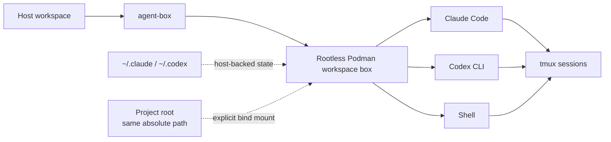

<div align="center">

# agent-box

**Run Claude Code and Codex CLI in isolated, reusable Podman workspaces.**

One project. One shared container. Your agents, shell, tools, state, and detachable sessions stay together without giving the container your whole host.

[](https://github.com/rus364/agent-box/actions/workflows/ci.yml)


</div>

---

## Why agent-box?

AI coding agents are useful, but running them directly on your workstation gives
them the same filesystem, credentials, tooling and process access that you have.

`agent-box` puts Claude Code and Codex CLI inside a transient rootless Podman
container while keeping the workflow close to local development:

- **Workspace isolation** — only the resolved project root and explicitly requested mounts are exposed.
- **Shared workspace box** — Claude, Codex and `agent-box shell` run in the same container for a project.
- **Same paths as the host** — a project at `/home/you/code/project` is at `/home/you/code/project` inside the box too.
- **Persistent agent state** — authentication, settings and history stay in host-backed `~/.claude` and `~/.codex`.
- **Detachable sessions** — interactive sessions run under tmux and survive a closed terminal or a dropped SSH connection.
- **Nothing exposed by accident** — every credential, every host directory and every optional capability is a switch you turned on.

> [!IMPORTANT]
> A workspace box is one trust boundary. Claude, Codex, shells, hooks and
> daemons inside the same box share the same Unix user and PID namespace.

## Installation

Requirements: Linux, Python 3.11+, Podman and Git. `gh` is optional, and only
for passing a GitHub token into the box. The launcher itself uses only the
Python standard library — there is nothing to build and nothing to install into
Python.

Git is a real dependency, not just how you get the code: agent-box asks it for
the repository root to decide what to mount, and reads it for the status line
and the auto-push safety checks.

**1. Clone it.** Anywhere you like; this is the whole program.

```bash
git clone https://github.com/rus364/agent-box.git ~/.local/src/agent-box
```

**2. Configure it.** Run it by path the first time — its first question is
putting `agent-box` on your PATH:

```bash
~/.local/src/agent-box/agent-box config
```

It offers the writable directories your PATH already has, or creates
`~/.local/bin` and adds it. The symlink and the shell startup line are two
separate questions, both declinable, and declining either prints the exact
command to run yourself. Everything after that is optional integrations, all
off by default.

**3. Authenticate the agents on the host.** agent-box mounts your existing
`~/.claude` and `~/.codex` rather than managing a second credential store, so
`claude` and `codex` should be logged in before the first launch.

**4. Run it.** The container image is built automatically on first use, which
takes a few minutes once:

```bash
cd ~/code/my-project
agent-box claude          # or: agent-box codex
```

Then, day to day:

```bash
agent-box shell       # shell in this project's box
agent-box attach      # reattach a detached session
agent-box stop        # end the box and every session in it
agent-box doctor      # verify the environment
agent-box upgrade     # move this checkout to the newest release
```

## How it works



The first command in a project creates its box lazily. Later Claude, Codex and
shell commands for the same workspace join that box with `podman exec`. A
different workspace gets a different box. When no useful workload remains, the
box exits and Podman's `--rm` removes it.

## Daily usage

```bash
agent-box                  # default agent: Claude
agent-box claude -p "summarize this repository"
agent-box codex exec "inspect this repository"

export AGENT_BOX_AGENT=codex     # change the default
```

### Detach and reattach

Interactive `claude`, `codex` and `shell` sessions run under tmux inside the
box, so closing the terminal detaches instead of orphaning. Detach on purpose
with `Ctrl-\ d`, come back with `agent-box attach`, and name a session
explicitly when several exist:

```bash
agent-box attach claude-31337
```

A detached session keeps its box alive; `agent-box stop` ends the box and every
session in it.

Only real terminals are wrapped — pipes, redirects, CI and `claude -p` write
straight to stdout. `AGENT_BOX_TMUX=0` disables tmux for one launch.

### Extra mounts

The project root is the only workspace path mounted automatically:

```bash
agent-box --mount ~/code claude
agent-box --mount /mnt/data/specs:ro --mount /srv/generated codex
```

Mounts keep their host absolute paths inside the container, and are read-write
unless you append `:ro`.

### Extra environment variables

```bash
agent-box --env DATABASE_URL=postgres://localhost/dev codex
agent-box --env MY_TOKEN claude
```

`--env NAME=VALUE` sets a variable. `--env NAME` forwards the value that name
already has in your shell *without* putting it in the process list, which is the
form to use for anything secret. Both are repeatable and both win over the lists
stored in `agent-box config`.

The same request works as a shell prefix:

```bash
AGENT_BOX_ENV_DATABASE_URL=postgres://localhost/dev agent-box codex
```

A bare `DATABASE_URL=... agent-box codex` cannot work, and the namespace is why:
inside the process, a variable set by a shell prefix is indistinguishable from
the hundreds inherited from your login profile, so honouring bare names would
mean handing the container your entire host environment.

### Host mode

```bash
agent-box --host claude
```

Runs the installed CLI directly, with your normal host environment and
credentials — no Podman. Flow-Next detection, review routing, Flowctl
resolution and auto-push policy are shared with container mode. The
[agent browser](docs/integrations/browser.md) is not: it is a capability of the
workspace image, and agent-box never rewrites your host agent configuration to
fake one.

## Configuration

One versioned JSON file:

```text
~/.config/agent-box/config.json
```

```bash
agent-box config        # ask, save, and apply
agent-box config show   # print current settings, tokens redacted
agent-box config check  # verify the Claude Telegram channel setup
agent-box config apply  # apply the saved file without asking anything
```

`agent-box config` ends by applying what you answered: installing the skills
your integrations need, linking them for Claude, rendering credential files, and
reconciling Claude's `settings.json`. `agent-box config apply` does the same
from the saved file, without any questions — which is what you want after
editing `config.json` by hand. `agent-box upgrade` applies on its own once it
has moved the checkout, so a newer agent-box never leaves you with its older
skills installed.

**Starting an agent applies nothing.** `agent-box claude` and `agent-box codex`
read your configuration but never install a skill, write a symlink or rewrite
`settings.json` on the way past. A launch is safe to run without wondering what
it will change in your home directory, and anything that shows up there is there
because you asked for it.

### Defaults

| Setting | Default | Purpose |
| --- | --- | --- |
| Claude status line | on | Workspace, git state, context and provider usage in one line |
| Git identity | on | `user.name` / `user.email`, for commit attribution |
| Provider transport settings | on | Base URL, proxies, CA bundle — without these a container behind a proxy cannot reach the network |
| Share skills with Claude | on | Link `~/.agents/skills` into `~/.claude/skills` |
| Image tool groups | analysis, kubernetes | What the workspace image is built with |
| Everything else | **off** | Credentials, task tracking, browser, notifications, auto-push |

Every switch and what it exposes: **[docs/integrations](docs/integrations/)**.

### Environment overrides

```text
AGENT_BOX_AGENT           Default agent when claude/codex is omitted
AGENT_BOX_IMAGE           Container image name
AGENT_BOX_KVM=0           Disable KVM passthrough
AGENT_BOX_GH_TOKEN=0|1    Withhold / force the GitHub token for one run
AGENT_BOX_WORKSPACE_ROOT  Override the resolved workspace root
AGENT_BOX_STATE_DIR       Override ~/.local/share/agent-box
AGENT_BOX_CONFIG_DIR      Override ~/.config/agent-box
AGENT_BOX_AGENTS_DIR      Override ~/.agents, the shared agent/skill tree
AGENT_BOX_STATUSLINE=0    Leave Claude's statusLine untouched when applying
AGENT_BOX_ENV_<NAME>      Set <NAME> inside the session
AGENT_BOX_TMUX=0          Disable tmux wrapping for one launch
```

## The workspace image

A base set everyone gets, plus optional groups you choose in `agent-box config`.

| Always | Included |
| --- | --- |
| Agents | Claude Code, Codex CLI |
| Languages | Python, uv, Node.js 22, Bun, mise |
| Source control | git, git-lfs, gh |
| Shell tooling | tmux, jq, ripgrep, fd, fzf, just, build essentials, network utilities |

| Optional group | Default | Included |
| --- | --- | --- |
| `analysis` | on | shellcheck, sqlite3, jscpd |
| `kubernetes` | on | kubectl, Helm, yq |
| `virtualization` | off | QEMU x86-64 + aarch64, OVMF; also gates `/dev/kvm` passthrough |
| `browser` | off | Playwright MCP + headless Chromium (see [agent browser](docs/integrations/browser.md)) |

Anything else your projects need belongs in the project, through `mise` — a
per-project toolchain is not an image everyone shares.

```bash
agent-box build      # normal cached build
agent-box update     # refresh frequently updated tools
agent-box rebuild    # rebuild without cache
```

Changing a group takes effect on the next `agent-box build`. The image records
what it was built with, so `agent-box config show`, `agent-box doctor` and any
launch will tell you when the running image no longer matches your
configuration — and none of them rebuild it behind your back.

Default image: `localhost/agent-box:latest`, overridable with `AGENT_BOX_IMAGE`.

## Integrations

All off by default and independent of each other. See
**[docs/integrations](docs/integrations/)** for the full set; briefly:

- **[Shared skills](docs/integrations/skills.md)** — one skill tree both agents read, plus three engineering-practice skills agent-box ships.
- **[Vikunja](docs/integrations/vikunja.md)** — task tracking both agents can read and update, installed and configured by agent-box itself.
- **[Flow-Next](docs/integrations/flow-next.md)** — review routing, Flowctl resolution, and fail-closed auto-push.
- **[Agent browser](docs/integrations/browser.md)** — a headless browser inside the box for agents to drive.
- **[Telegram](docs/integrations/telegram.md)** — Anthropic's official control channel, plus one-way notifications.
- **[Git and GitHub](docs/integrations/git.md)** — what of your Git and GitHub setup reaches a session.

## Usage and status line

```bash
agent-box usage codex
agent-box usage claude
agent-box usage all
```

```text
97/88 · 4h51m/5d23h │ 83/61 · 3h24m/4d11h
```

Segments are unlabeled: Claude first, Codex second, each in its own muted hue
(terracotta and steel blue; the status line adds violet for context).
Single-provider invocations print plain — the colours exist only to separate
segments from each other.

Claude Code can also use:

```bash
agent-box statusline
```

which renders workspace, git state, context usage and provider limits in one
line. It is enabled by default, but agent-box fills Claude's `statusLine` slot
only when that slot is empty, and removes only its own command when switched off
— a status line you configured yourself is never touched.

That slot lives in `~/.claude/settings.json`, which Claude sessions started
outside agent-box read too, so the line follows you there as well.
`AGENT_BOX_STATUSLINE=0` leaves the file alone while applying, and
`agent-box uninstall` takes the line back out for good.

## Workspace and security model

Workspace resolution is intentionally simple:

1. Inside a Git repository or worktree: its top-level directory.
2. Outside Git: the current directory.
3. `AGENT_BOX_WORKSPACE_ROOT` overrides both, when you deliberately want a broader tree.

Every workspace box runs with:

```text
--userns=keep-id
--cap-drop=all
--security-opt=no-new-privileges
```

The container user mirrors the host user's real passwd identity, so files
created inside the workspace map back to you rather than to root. Only the
workspace root, explicit extra mounts, agent state directories and the
integrations you enabled are exposed.

`$HOME` is never consulted for any of this: paths come from the passwd entry, so
a poisoned environment cannot move a bind mount, a state directory or the
container's home.

## Updating

```bash
agent-box upgrade           # fetch, move to the newest release, apply
agent-box upgrade --check   # report what is available, change nothing
```

Installing agent-box is a `git clone`, so upgrading it is a git operation on
that checkout: it moves to the newest release tag, or fast-forwards the
tracking branch while the repository has no tags yet. It refuses on a checkout
with uncommitted changes or with commits no remote has — that is a working
copy, not an installation, and the alternative to refusing would be stashing
your work. Afterwards it applies your saved configuration, because the skills
agent-box ships live in the checkout that just moved.

Changing the tool groups still needs an explicit `agent-box build`; upgrading
says when the image has drifted and leaves the decision to you.

## Uninstalling

```bash
agent-box uninstall
```

Removes what agent-box wrote in places it does not own: its status line and
hooks in Claude's `settings.json`, the skill links in `~/.claude/skills`, the
skills it installed in `~/.agents/skills`, its rendered credential files, the
symlink it put on your PATH, and every workspace box. Anything you wrote
yourself in those places stays.

The PATH line in your shell startup file is the exception. It is left alone by
default — a stray `export PATH` costs nothing, while deleting the wrong two
lines of a login shell's startup file costs a lot — and `--purge` removes it
only if it still matches, character for character, what agent-box wrote. An
edited block is reported with its file and line numbers for you to decide
about, never guessed at.

Your configuration and state survive, so running `agent-box config` again picks
up where you left off. Add `--purge` to delete those too — that includes stored
tokens, so it asks first unless you pass `--yes`. The container image and this
checkout are never removed for you; the command prints how.

## Diagnostics and tests

```bash
agent-box doctor      # inside a real box: tools, credentials, integrations
agent-box selftest    # fast, no Podman, no network
python3 -m unittest discover -s tests
```

The full suite exercises workspace resolution, identity handling, configuration
gates, mounts, tmux and session lifecycle, notifications, Flow-Next policy, Git
safety checks, skill installation and container behaviour.

## Troubleshooting

<details>
<summary><strong>Podman is missing</strong></summary>

Install Podman. agent-box intentionally does not fall back to Docker.

</details>

<details>
<summary><strong>Claude or Codex is not authenticated</strong></summary>

Authenticate the corresponding CLI on the host first. agent-box mounts the
host-backed agent state rather than managing a second credential store.

</details>

<details>
<summary><strong><code>gh</code> is unauthenticated inside the box</strong></summary>

That is the default. See [Git and GitHub](docs/integrations/git.md).

</details>

<details>
<summary><strong>The configured workspace root rejects my current directory</strong></summary>

`AGENT_BOX_WORKSPACE_ROOT` is set and the current directory is outside it.
Change directory, or remove the override.

</details>

<details>
<summary><strong>A tool I expected is missing from the box</strong></summary>

Check `agent-box config show` — its group may be off — then `agent-box build`.
Project-specific toolchains belong in the project, declared through `mise`.

</details>

<details>
<summary><strong>A shared skill is missing or points somewhere unexpected</strong></summary>

Run `agent-box doctor`, then `agent-box config apply`. agent-box never
overwrites a skill directory or a link it did not create; it says so and keeps
yours.

</details>

## Known limitations

- Linux + Podman only.
- Workspace containers are transient. Detached tmux sessions survive terminal loss, but not a host reboot or a forced container kill.
- `~/.agents` is exposed as a whole tree, not only `skills/`; it is read-only except for the read-write `skills/` subtree and its external symlink targets.
- The agent browser is amd64/arm64 only, because those are the architectures Playwright publishes Chromium builds for.
- `agent-box update` re-downloads the browser layer, because it sits below the tools-refresh marker that Node.js also sits below. A plain `agent-box build` keeps it cached.
- The official Claude Telegram plugin is outside agent-box's control and may need compatibility updates when its internals change.
- There is no remote equivalent of `--mount`, and Telegram cannot create a new workspace box by itself.

## Project scope

agent-box is deliberately a **local workspace runtime**, not an agent platform.

It provides isolated local Claude/Codex execution, workspace lifecycle, mounts
and identity handling, detachable sessions, controlled credential exposure, and
the local integrations above.

It does **not** implement its own cloud scheduler, multi-user control plane,
Telegram bot platform, or Codex remote-control protocol.

## License

MIT — see [LICENSE](LICENSE).

The skills under `agent_box/skills/` vendored from
[obra/superpowers](https://github.com/obra/superpowers) are MIT-licensed by
their author and carry their own `LICENSE`; `agent_box/skills/VENDORED.json`
records the exact upstream release each copy came from.
