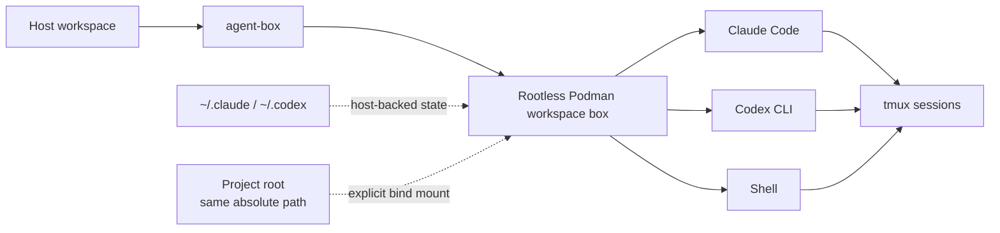

<div align="center">

# agent-box

**Run Claude Code and Codex CLI in isolated, reusable Podman workspaces.**

One project. One shared container. Your agents, shell, tools, state, and detachable sessions stay together without giving the container your whole host.

[](https://github.com/rus364/agent-box/actions/workflows/ci.yml)


</div>

---

## Why agent-box?

AI coding agents are useful, but running them directly on your workstation gives them the same filesystem, credentials, tooling, and process access that you have.

`agent-box` puts Claude Code and Codex CLI inside a transient rootless Podman container while keeping the workflow close to local development:

- **Workspace isolation** — only the resolved project root and explicitly requested mounts are exposed.
- **Shared workspace box** — Claude, Codex, and `agent-box shell` run in the same container for a project.
- **Same paths as the host** — `/home/alex/code/project` stays `/home/alex/code/project` inside the container.
- **Persistent agent state** — authentication, settings, and history remain in host-backed `~/.claude` and `~/.codex`.
- **Detachable sessions** — interactive sessions run through tmux and can be reattached after a terminal or SSH connection disappears.
- **Explicit secret exposure** — GitHub credentials, provider keys, and other sensitive integrations are opt-in.
- **Flow-Next aware** — deterministic review routing, Flowctl resolution, and optional fail-closed auto-push.

> [!IMPORTANT]
> A workspace box is one trust boundary. Claude, Codex, shells, hooks, and daemons inside the same box share the same Unix user and PID namespace.

## Quick start

### Requirements

- Linux
- Python 3.11+
- Podman

The launcher itself uses only the Python standard library.

### Install

```bash
git clone https://github.com/rus364/agent-box.git ~/.local/src/agent-box
ln -s ~/.local/src/agent-box/agent-box ~/.local/bin/agent-box
```

Make sure `~/.local/bin` is on `PATH`.

### Start an agent

```bash
cd ~/code/my-project

agent-box claude
# or
agent-box codex
```

The image is built automatically on first use.

Useful commands:

```bash
agent-box shell       # shell in this project's shared box
agent-box attach      # reattach a detached interactive session
agent-box stop        # stop the box and every session in it
agent-box doctor      # verify the environment
agent-box config      # configure optional integrations
```

## How it works



The first local command in a project creates its box lazily. Later Claude, Codex, and shell commands for the same workspace join that box with `podman exec`.

A different workspace gets a different box. When no useful workloads remain, the box exits and Podman's `--rm` removes it automatically.

## Daily usage

### Claude Code and Codex

```bash
agent-box                  # default agent: Claude
agent-box claude
agent-box claude -p "summarize this repository"

agent-box codex
agent-box codex exec "inspect this repository"
```

Change the default agent if desired:

```bash
export AGENT_BOX_AGENT=codex
```

### Detach and reattach

Interactive `claude`, `codex`, and `shell` sessions run under tmux inside the workspace box.

Detach intentionally with:

```text
Ctrl-\  d
```

Then return with:

```bash
agent-box attach
```

If several sessions exist, `agent-box attach` lists them and you can select one explicitly:

```bash
agent-box attach claude-31337
```

A detached session keeps the box alive. `agent-box stop` ends the entire workspace box and every session in it.

Only real terminals are wrapped. Pipes, redirects, CI, `claude -p`, and similar non-interactive runs go directly to stdout. Disable tmux for one launch with:

```bash
AGENT_BOX_TMUX=0 agent-box claude
```

### Host mode

Need the same launcher policy without the container?

```bash
agent-box --host claude
agent-box --host codex
```

Host mode runs the installed CLI directly with your normal host environment and credentials. Flow-Next detection, review routing, Flowctl resolution, and auto-push policy are shared with container mode.

The [agent browser](#agent-browser) is **not** shared with host mode. It is a capability of the workspace image, so `--host` sessions never gain it, and agent-box never rewrites your host Claude or Codex MCP configuration to fake one. A host session that needs a browser should configure one itself, in your own agent config.

### Extra mounts

The project root is the only workspace path mounted automatically. Add other host directories explicitly:

```bash
agent-box --mount ~/code claude
agent-box --mount /mnt/data/specs:ro codex
agent-box --mount /mnt/data/specs:ro --mount /srv/generated claude
```

Mounts keep their host absolute paths inside the container. They are read-write by default; append `:ro` for read-only access.

## What's in the image?

The development image includes the tools needed for normal agent-driven infrastructure and software work:

| Area | Included |
| --- | --- |
| Agents | Claude Code, Codex CLI |
| Languages | Python, uv, Node.js 22, Bun, mise |
| Source control | git, git-lfs, gh |
| Kubernetes | kubectl, Helm, yq, jq |
| Virtualization | QEMU x86-64 + aarch64, optional KVM passthrough |
| Browser automation | Playwright MCP + headless Chromium (opt-in; see [Agent browser](#agent-browser)) |
| Session/runtime tools | tmux and common build/network utilities |

Build commands:

```bash
agent-box build      # normal cached build
agent-box update     # refresh frequently updated tools
agent-box rebuild    # rebuild without cache
```

Default image: `localhost/agent-box:latest`.

Override it with `AGENT_BOX_IMAGE`.

## Configuration

`agent-box` keeps its settings in one versioned JSON file:

```text
~/.config/agent-box/config.json
```

Manage it with:

```bash
agent-box config
agent-box config show
agent-box config check
```

Important defaults:

| Setting | Default | Purpose |
| --- | --- | --- |
| Claude Telegram channel | off | Enable Anthropic's official Telegram channel plugin |
| Claude status line | on | Show workspace/context/provider usage |
| Outbound Telegram notifications | off | Turn-complete / waiting / failure notifications |
| GitHub token forwarding | off | Expose host GitHub authentication to agent sessions |
| Full host Git config | off | Copy host Git config into the box |
| Provider API keys | off | Forward Anthropic provider credentials |
| Vikunja | off | Task tracking for both agents, installed and configured by agent-box |
| Agent browser | off | Let containerized agents drive a headless browser |
| Share skills with Claude | on | Link `~/.agents/skills` into `~/.claude/skills` |
| Extra environment variables | none | Forward or set variables your own projects need |
| Flow-Next auto-push | off | Push eligible completed Flow-Next work automatically |
| Flow-Next review backend | unset | Which backend reviews the work, per primary agent |

<details>
<summary><strong>Environment overrides</strong></summary>

```text
AGENT_BOX_AGENT           Default agent when omitted
AGENT_BOX_IMAGE           Container image name
AGENT_BOX_KVM=0           Disable KVM passthrough
AGENT_BOX_GH_TOKEN=0|1    Withhold / force GitHub token for one run
AGENT_BOX_WORKSPACE_ROOT  Override the resolved workspace root
AGENT_BOX_STATE_DIR       Override ~/.local/share/agent-box
AGENT_BOX_CONFIG_DIR      Override ~/.config/agent-box
AGENT_BOX_AGENTS_DIR      Override ~/.agents, the shared agent/skill tree
AGENT_BOX_STATUSLINE=0    Leave Claude's statusLine untouched for one run
AGENT_BOX_TMUX=0          Disable tmux wrapping for one launch
```

</details>

## Git and GitHub credentials

Git and GitHub integration is intentionally conservative.

Being logged in to `gh` on the host does **not** automatically give every workspace container a live GitHub credential. Enable it explicitly through `agent-box config`.

Container Git/gh configuration is copied into a per-workspace writable snapshot rather than bind-mounted directly. The host remains the source of truth, while temporary changes made inside a box disappear with that box.

Only HTTPS GitHub authentication is forwarded. SSH keys and the host SSH agent are not mounted.

## Flow-Next integration

A workspace is treated as Flow-Next when its root contains:

```text
.flow/config.json
```

agent-box then provides deterministic runtime policy without requiring every project to duplicate it in `AGENTS.md`.

### Review routing

Nothing is routed until you say so. `agent-box config` offers the backends worth choosing between and stores your answer per primary agent:

```json
{
  "flow_next": {
    "review_backends": {
      "claude": "codex:gpt-5.6-sol:medium"
    }
  }
}
```

A configured agent gets `FLOW_REVIEW_BACKEND` on every launch; an agent with no entry gets no variable, so Flow-Next keeps resolving the backend from `.flow/config.json` as it would without agent-box. An explicit `FLOW_REVIEW_BACKEND` in the shell wins for that one launch.

Primary agent selection is always explicit. agent-box never chooses between Claude and Codex based on quota, cost, or heuristics.

### Flowctl

For Flow-Next workspaces, agent-box resolves the actual Flowctl installation separately for each agent and makes bare `flowctl` available for that invocation.

- Claude: from the installed `flow-next` plugin record.
- Codex: from `${CODEX_HOME:-~/.codex}/scripts/flowctl`.

No global symlink is required.

### Auto-push

`flow_next.auto_push` is opt-in and fail-closed.

At the end of an agent turn, agent-box may run:

```bash
git push -u origin HEAD
```

—but only after proving that the current branch, remote destination, remote default branch, worktree state, divergence state, and touched Flow-Next task receipts are safe and that Flow-Next itself reports at least one touched task as authoritatively `done`.

Any ambiguity skips the push. agent-box never force-pushes, rebases, merges, resets, changes branches, or guesses a destination.

<details>
<summary><strong>Auto-push safety model</strong></summary>

The reconciler checks the actual effective push destination, queries the remote live rather than trusting stale `origin/HEAD`, rejects `main`/`master`, detached HEADs, dirty worktrees, divergent remote branches, ambiguous push URLs, unresolved Flowctl, malformed state, and task completion that exists only in committed snapshots instead of Flow-Next runtime state.

It also disables `push.followTags` and `push.recurseSubmodules` for the push subprocess so a plain branch push cannot silently publish unrelated tags or submodule changes.

There is no persistent auto-push marker. Every completion event recomputes the answer from current Git and Flow-Next state.

</details>

## Claude Telegram channel

Remote control of Claude is provided by Anthropic's official `telegram@claude-plugins-official` plugin.

agent-box does not implement its own Telegram control daemon, pairing protocol, session router, or permission bridge.

Enable the plugin once from Claude Code:

```text
agent-box claude
/plugin install telegram@claude-plugins-official
/telegram:configure <BOT_TOKEN>
```

Then enable the channel in:

```bash
agent-box config
```

Start a fresh Claude session and pair your Telegram account:

```text
/telegram:access pair <code>
/telegram:access policy allowlist
```

Only one Claude session can own Telegram polling for a bot token at a time. agent-box tracks that owner and prevents another local session from accidentally stealing the official plugin's poller.

> [!NOTE]
> Codex remote control is not implemented by agent-box. Use OpenAI's official ChatGPT/Codex remote-control experience where supported.

## Notifications

Outbound notifications are separate from remote control.

```bash
agent-box config
agent-box notify test
```

Notifications are one-way only:

- Codex: turn completed, including the final assistant message.
- Claude: waiting for input, permission required, completed, or failed.

When a Claude session already owns the official Telegram channel, duplicate interaction notifications are suppressed while lifecycle completion/error signals remain available.

## Shared skills

`~/.agents/skills` is the canonical shared skill directory.

Codex discovers it directly. Before starting Claude, agent-box exposes matching skills through `~/.claude/skills` symlinks so both agents consume the same `SKILL.md` files. Those symlinks live in your real Claude configuration, which Claude sessions started outside agent-box also read, so they are a setting rather than an assumption — turn them off in `agent-box config` and agent-box removes the ones it made, leaving anything else in that directory alone.

agent-box also installs the skills its own integrations need into this tree, marks them as its own, and refreshes them when it ships newer copies. A skill you created yourself under the same name has no such marker and is never overwritten.

If `~/.agents` exists, the whole tree is mounted read-only, with `~/.agents/skills` overlaid read-write so agents can create and update their own skills. External targets linked from `skills/` are read-write too; targets linked only from elsewhere in the tree remain read-only. This keeps every shared symlink resolving at its host path without granting write access to unrelated agent definitions or prompt material.

## Vikunja

Task tracking both agents can read and update. Off by default; there is nothing to install or configure on the host first.

```bash
agent-box config
```

Answer yes, then give it a server URL and an API token. agent-box installs its own copy of the Vikunja skill into `~/.agents/skills/vikunja`, keeps the URL and token in its own `config.json` (mode 0600), and hands the container a rendered, read-only copy of just those two values — never its own configuration file. `~/.local/state/vikunja` is mounted read-write so a partially applied `vikunja import` stays resumable across boxes, and the skill's CLI is put on the container `PATH`.

A skill directory agent-box installed carries a marker and is refreshed when agent-box ships a newer copy. A `~/.agents/skills/vikunja` you created yourself has no such marker and is never overwritten.

The address the container receives is corrected, because rootless Podman gives the container both its own loopback and the host's own addresses:

- an address with no name worth keeping — `localhost`, or an IP literal belonging to this machine — is rewritten to `host.containers.internal`, preserving scheme, port and path;
- a DNS name that resolves to this machine, such as `http://pm.example.org:3456`, keeps its URL and is redirected with `--add-host=pm.example.org:host-gateway`, so TLS certificate validation and reverse-proxy virtual-host routing still see the name the server was configured for;
- a genuinely remote Vikunja is left alone.

The URL you configured is never rewritten in place; only the container's copy is.

Verify it with:

```bash
agent-box doctor
```

## Agent browser

Off by default. When enabled, containerized Claude and Codex sessions get an MCP server that drives a real headless browser, so an agent can open a page, read it, follow links and fill forms on its own — useful for reading documentation, checking a locally served app, or reproducing something that only shows up in a browser.

```text
Claude / Codex
      |
      | stdio MCP
      v
Playwright MCP
      |
      v
headless Chromium
```

All three run inside the workspace container that is already there. There is no browser sidecar, no Podman pod, no HTTP MCP service, no host browser integration and no X11/Wayland forwarding.

### Enabling it

```bash
agent-box config
```

Answer yes to *"Let containerized agents drive a headless browser"*. It applies to the next `agent-box claude` and `agent-box codex`; there is nothing to restart, because the browser is not part of the container's identity — turning it on or off never rebuilds or destroys a running workspace box.

Both agents see the server under the same name:

```text
agent_box_browser
```

It is added for that invocation only. Your `~/.codex/config.toml` and your Claude MCP configuration are never rewritten, and the MCP servers you configured yourself keep working alongside it.

### What it does and does not touch

| | |
| --- | --- |
| Browser | Chromium, headless, from the image — installed at build time, never downloaded during a session |
| Profile | Isolated and in-memory, new for every session |
| Cookies / logins / localStorage | Discarded when the session ends |
| Your own browser's profile and cookies | Never exposed — nothing from the host is mounted |
| Screenshots, snapshots, traces | Written under `~/.local/share/agent-box/runtime/workspaces/<id>/browser/<session>/output`, never into your repository |
| Concurrent sessions | Separate profile and output directory each |

Because every session is isolated, an agent cannot reuse a login from an earlier session, and cannot reach a site that depends on your own browser's authentication. That is deliberate: a page the agent visits must not be able to act as you.

### Trust boundary

> [!IMPORTANT]
> Browser automation is **not** a separate security boundary. The browser, the Playwright MCP server, Claude/Codex, shell processes, the mounted project, and every other enabled integration all live inside the same workspace box, as the same Unix user. Content the browser loads is on the *inside* of that boundary, and anything a page can persuade the agent to do, the agent can already do to your project.

Treat enabling the browser the way you would treat handing the agent any other network-reading capability: the container still runs with `--cap-drop=all`, `--security-opt=no-new-privileges` and rootless `--userns=keep-id`, and none of that is relaxed for the browser. Chromium's own internal sandbox is unavailable under those flags — Playwright launches its bundled Chromium with `--no-sandbox`, as it does in any container — and agent-box does not weaken the Podman hardening to change that. The container, not Chromium, is the boundary.

### Upgrading an existing install

Browser support ships in the image, so an image built before this feature has neither Playwright MCP nor Chromium:

```bash
agent-box build     # normal cached build; adds the browser layers
```

Use `agent-box update` instead if you also want the agent CLIs refreshed. After that, a plain `agent-box build` keeps the browser layers cached; `agent-box update` re-downloads them each time, because it invalidates everything from Node.js down. `agent-box doctor` says plainly when the running image predates browser support.

### Checking it

```bash
agent-box doctor
```

Disabled — a normal state, not an error:

```text
playwright-mcp:      Version 0.0.80
browser integration: disabled (enable it with 'agent-box config')
```

Enabled and healthy. The check actually starts a headless Chromium, renders an offline `data:` URL and exits; it needs no network and is bounded by a short timeout:

```text
playwright-mcp:      Version 0.0.80
browser chromium:    OK (153.0.8010.12)
browser integration: enabled
```

## Usage and status line

Check provider subscription usage from the host:

```bash
agent-box usage codex
agent-box usage claude
agent-box usage all
```

Example combined output:

```text
97/88 · 4h51m/5d23h │ 83/61 · 3h24m/4d11h
```

Segments are unlabeled: Claude comes first, Codex second, each in its own muted hue (terracotta and steel blue; the status line adds violet for context). Single-provider invocations print plain — the colours exist only to separate segments from each other.

Claude Code can also use:

```bash
agent-box statusline
```

which renders workspace, Git state, context usage, and provider limits in one line.

The managed status line is enabled by default, but agent-box never overwrites a status line you configured yourself: it fills Claude's `statusLine` slot only when that slot is empty, and removes only its own command when switched off.

That slot lives in `~/.claude/settings.json`, which Claude sessions started outside agent-box read too, so the line follows you there as well. `AGENT_BOX_STATUSLINE=0` leaves the file untouched for one run, and `agent-box uninstall` takes the line back out for good.

## Workspace and security model

Workspace resolution is intentionally simple:

1. Inside a Git repository/worktree: use its top-level directory.
2. Outside Git: use the current directory.
3. `AGENT_BOX_WORKSPACE_ROOT` overrides both when you deliberately want a broader tree.

Every workspace box uses:

```text
--userns=keep-id
--cap-drop=all
--security-opt=no-new-privileges
```

The container user mirrors the host user's real passwd identity. Files created inside the workspace therefore map back to the host user instead of root.

Only the workspace root, explicit extra mounts, agent state/config locations, and configured integrations are exposed.

Nothing in the optional [agent browser](#agent-browser) relaxes any of this: it adds no capability, no socket passthrough and no host mount, and no host browser profile or cookie store is ever exposed to the container.

KVM is passed through automatically when `/dev/kvm` is accessible. Disable it with:

```bash
AGENT_BOX_KVM=0 agent-box claude
```

## Diagnostics and tests

```bash
agent-box doctor
agent-box selftest
python3 -m unittest discover -s tests
```

`selftest` is fast and requires neither Podman nor network access. The full suite exercises workspace resolution, identity handling, configuration gates, mounts, tmux/session lifecycle, notifications, Flow-Next policy, Git safety checks, and container behavior.

## Troubleshooting

<details>
<summary><strong>Podman is missing</strong></summary>

Install Podman. agent-box intentionally does not fall back to Docker.

</details>

<details>
<summary><strong>Claude or Codex is not authenticated</strong></summary>

Authenticate the corresponding CLI on the host first. agent-box mounts the host-backed agent state rather than managing a second credential store.

</details>

<details>
<summary><strong><code>gh</code> is unauthenticated inside the box</strong></summary>

This is the default. Enable `github.gh_token` in `agent-box config`. Optionally enable `github.gh_config` if the container also needs the host gh configuration snapshot.

</details>

<details>
<summary><strong>The configured workspace root rejects my current directory</strong></summary>

`AGENT_BOX_WORKSPACE_ROOT` is set and the current directory is outside it. Change directory or remove/update the override.

</details>

<details>
<summary><strong><code>agent-box doctor</code> says the browser is missing</strong></summary>

The running image was built before browser support existed. Run `agent-box build` once; the Playwright MCP and Chromium layers are added and then stay cached.

</details>

<details>
<summary><strong>The agent says it has no browser tools</strong></summary>

Check `agent-box config show` — `Agent browser (containers)` must be `on`. It only applies to containerized sessions: `agent-box --host claude` and `agent-box --host codex` never get it. Note also that the server is added per invocation, so a session started before you enabled it keeps running without the browser; start a new one.

</details>

<details>
<summary><strong>The agent cannot open a site that needs me to be logged in</strong></summary>

Expected. Each session gets an isolated, in-memory profile and your own browser's cookies are never exposed, so there is no session for the agent to reuse. Have the agent log in within its own session, or point it at something that does not require your credentials.

</details>

<details>
<summary><strong>Chromium fails to start inside the box</strong></summary>

Run `agent-box doctor`; the browser check prints the launch error. Chromium needs a writable `$HOME/.config` for its crash-reports database, which the image provides — an image built by hand without agent-box's build args, or a stale one, can lack it. Rebuild with `agent-box build`. A `chrome_crashpad_handler: --database is required` message is that failure.

</details>

<details>
<summary><strong>Screenshots or snapshots are cluttering my repository</strong></summary>

They should not be: agent-box points Playwright MCP at a per-session output directory under `~/.local/share/agent-box/runtime/workspaces/<id>/browser/`. An agent that writes into the project is doing so with its ordinary file tools, not through the browser. `agent-box stop` clears that workspace's browser output.

</details>

<details>
<summary><strong>A shared skill is missing or mismatched</strong></summary>

Run `agent-box doctor`. If `~/.claude/skills/<name>` already exists and points somewhere else, agent-box preserves it instead of overwriting it.

</details>

## Known limitations

- Linux + Podman only.
- Workspace containers are transient. Detached tmux sessions survive terminal loss, but not a host reboot or forced container kill.
- `~/.agents` is exposed as a whole tree, not only `skills/`; the tree is read-only except for the read-write `skills/` subtree and its external symlink targets.
- The agent browser is amd64/arm64 only, because those are the architectures Playwright publishes Chromium builds for; the image build fails with an explanation elsewhere.
- `agent-box update` re-downloads the browser layer, because it sits below the tools-refresh marker that Node.js also sits below. A plain `agent-box build` keeps it cached.
- The official Claude Telegram plugin is outside agent-box's control and may require compatibility updates when its internals change.
- There is no remote equivalent of `--mount`, and Telegram cannot create a new workspace box by itself.

## Uninstalling

```bash
agent-box uninstall
```

Removes what agent-box wrote in places it does not own: its status line and hooks in Claude's `settings.json`, the skill links in `~/.claude/skills`, the skills it installed in `~/.agents/skills`, its rendered credential files, and every workspace box. Anything you wrote yourself in those places is left exactly where it is.

Your configuration and state survive, so reinstalling picks up where you left off. Add `--purge` to delete those too — that includes any stored tokens, so it asks first unless you pass `--yes`. The container image and this checkout are never removed for you; the command prints how.

## Project scope

agent-box is deliberately a **local workspace runtime**, not an agent platform.

It provides:

- isolated local Claude/Codex execution;
- workspace lifecycle;
- mounts and identity handling;
- detachable sessions;
- controlled credential exposure;
- local integrations such as Flow-Next, notifications, and shared skills.

It does **not** implement its own cloud scheduler, multi-user control plane, Telegram bot platform, or Codex remote-control protocol.
