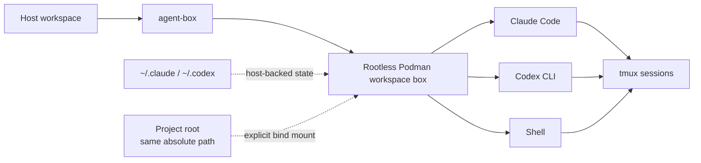

<div align="center">

# agent-box

**Run Claude Code and Codex CLI in isolated, reusable Podman workspaces.**

One project. One shared container. Your agents, shell, tools, state, and detachable sessions stay together without giving the container your whole host.

[](https://github.com/rus364/agent-box/actions/workflows/ci.yml)


</div>

---

## Why agent-box?

AI coding agents are useful, but running them directly on your workstation
gives them the same files, credentials, tools and processes that you have.
agent-box runs Claude Code and Codex CLI inside a rootless Podman container
while keeping the workflow close to local development:

- **Workspace isolation** — only the project root and the mounts you ask for are exposed.
- **One box per project** — Claude, Codex and `agent-box shell` share the same container.
- **Same paths as the host** — `/home/you/code/project` is `/home/you/code/project` inside the box too.
- **Persistent agent state** — logins, settings and history stay in your host's `~/.claude` and `~/.codex`.
- **Detachable sessions** — sessions run under tmux and survive a closed terminal or a dropped SSH connection.
- **Nothing exposed by accident** — every credential, host directory and optional capability is a switch you turn on.

> [!IMPORTANT]
> A workspace box is one trust boundary. Claude, Codex, shells, hooks and
> daemons inside the same box share the same Unix user and PID namespace.

## Requirements

- Linux
- Python 3.11 or newer (standard library only)
- Rootless Podman 5.0 or newer — agent-box does not fall back to Docker
- Git
- Optional: `gh`, to pass a GitHub token into the box

agent-box checks all of this before starting a box and prints the command that
fixes anything missing. Details: [Installation](docs/installation.md#requirements).

## Installation

```bash
# 1. Install with an account that has repository access.
uv tool install 'git+ssh://git@github.com/rus364/agent-box.git'
uv tool update-shell   # if the installer reports PATH setup is needed

# 2. Reopen the shell if PATH changed, then configure integrations.
agent-box config
```

The distribution is `agent-box-tool`; the command stays `agent-box`.
[pipx and editable installs](docs/installation.md) are also supported.

3. Log in with `claude` and `codex` on the host; agent-box reuses those logins.
4. Start a session in your project. The workspace image is built automatically
   the first time, which takes a few minutes once.

```bash
cd ~/code/my-project
agent-box claude          # or: agent-box codex
```

Shell completion, updating and uninstalling are covered in
[Installation](docs/installation.md).

## Quick start

```bash
agent-box                 # the default agent (Claude unless you choose Codex)
agent-box shell           # a shell in this project's box
agent-box attach          # reattach a detached session (detach with Ctrl-\ d)
agent-box stop            # end the box and every session in it
agent-box --host codex    # run the host's CLI directly, without a container
agent-box doctor          # check the box and its integrations
```

Options before the agent apply to one launch, for example
`agent-box --mount ~/specs:ro --env DATABASE_URL claude`. See
[Usage](docs/usage.md) for all of them.

## How it works



**Workspace box.** The first command in a project creates its box; later
commands join it. A different project gets a different box, and a box with no
workload left exits and is removed. The box mounts the Git top level of the
current directory and your agent state; any other host path, credential or
device only when you enable it.

**Host mode.** `--host` runs your installed `claude` or `codex` directly, with
your own environment and credentials. Tracker, workflow and model routing
behave the same; container-only features such as mounts and the agent browser
do not apply.

**Configuration.** Built-in defaults, then your global
`~/.config/agent-box/config.json`, then the repository's `.agent-box.json`.
`agent-box config` edits settings and applies integrations. The first host launch
after a package update refreshes configured integrations automatically; unchanged
launches leave them alone. See [compatibility and upgrades](docs/compatibility.md).

## Documentation

| Page | What it covers |
| --- | --- |
| [Installation](docs/installation.md) | Requirements, setup, shell completion, updating, uninstalling |
| [Usage](docs/usage.md) | Sessions, options, mounts, environment, host mode, usage limits and status line |
| [Configuration](docs/configuration.md) | The menu, defaults, project configuration, `config ai` |
| [Workspace image](docs/image.md) | Included tools, optional groups, building and refreshing |
| [Security model](docs/security.md) | What a box can reach and how it is hardened |
| [Integrations](docs/integrations/README.md) | Tracker and workflow, browser, k3s, Telegram, credentials and more — all optional |
| [Troubleshooting](docs/troubleshooting.md) | Diagnostics, common problems, known limitations |

The full index, including design records for contributors, is in
[docs/](docs/README.md).

## License

MIT — see [LICENSE](LICENSE).
